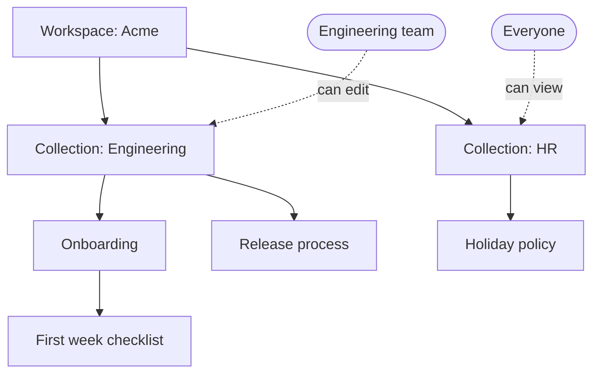

# Use case 1: Build a team knowledge base

**Scenario:** you are setting up a shared knowledge base for the Engineering team of a fictional company, Acme Insurance. You want a place where people can find how things are done, and where each topic has a clear home.

**Goal:** create collections and documents, and understand how they relate to each other and to the people who use them.

**Time:** about 15 minutes. **Data:** fictional only.

## The cast

| Piece | In this scenario |
|---|---|
| **Workspace** | Acme's whole Outline. |
| **Collection** | A top-level folder per team or topic: `Engineering`, `HR`. |
| **Document** | A page: `Onboarding`, `Release process`. |
| **Child document** | A page nested under another: `First week checklist` under `Onboarding`. |
| **People** | Who can see and edit each collection. |



## Step 1: Create the two collections

1. In the left sidebar click **New collection**. Name it `Engineering`.
2. Do it again for `HR`.

**You should see:** both under **Collections** in the sidebar.

**Why it matters:** the collection is the unit of access. Everything you put inside inherits who can see it.

## Step 2: Add documents to Engineering

1. Open `Engineering` and click **New doc**. Title: `Onboarding`. Write a short welcome paragraph. Publish it.
2. Add a second document. Type `Release process` in the **title** field, then click into the **body** and paste this fictional text (without a heading, because the title is already the heading). It deliberately has weak spots, and use case 2 will use them. Publish it.

```
1. Make sure all tests pass.
2. Ask the team lead for approval over email.
3. Deploy to the staging server and check it looks fine.
4. Deploy to production on Friday afternoon.
5. Tell the team when it is done.
```

**You should see:** two documents under `Engineering` in the sidebar, and the five numbered steps inside `Release process`.

**Check before moving on:** close `Release process` and open it again. The five steps must still be there. Use cases 1 (search) and 2 (agent review) both depend on this text being saved in the document.

## Step 3: Nest a document

1. Open `Onboarding` and create a child document inside it (look for the option to add a nested document). Title: `First week checklist`. Add a few bullet points.
2. Look at the sidebar: `Engineering` > `Onboarding` > `First week checklist`.
3. Drag `Release process` onto `Onboarding`. It becomes a child. Drag it back to the collection level.

**You should see:** the tree changes as you drag. The tree is the structure of your knowledge base.

**Why it matters:** nesting says "this page belongs to that topic". A child follows its parent when you move it.

## Step 4: Add the HR collection content

1. In `HR`, create `Holiday policy` with two lines of fictional text. Publish it.

**You should see:** two collections with separate content. Nothing in `HR` appears under `Engineering`.

## Step 5: See the relationships from the other side

1. Open `Engineering` and click through its tabs: **Overview**, **Documents**, **Popular**, **Recently updated**. The same documents, seen through different filters.
2. Open a document and look at the top: the breadcrumb shows where it lives (collection > parent > document).
3. Open **Search** (or press `/`) and look for the word `staging`. The result points to `Release process`, with its location. Search reads the text inside published documents, not only titles.
   - **If nothing comes up:** open `Release process` and check that the five steps are really in the body. Search can only find words that are saved in a published document. A different word you wrote yourself works just as well, and the result shows the document it came from.
4. Star `Release process`. It also appears under **Starred** on **Home**. A star is personal. Other people won't see it.

**Why it matters:** one document, many ways to find it: by structure, by filter, by search, by your own shortcuts.

## Step 6: Check who has access

1. Open `Engineering` and look for **Permissions** (in the collection's menu). You'll see who has access and at which level: **View only**, **Can edit** or **Manage**.
2. Open **Settings > Users**. You'll see yourself as **Admin**. The roles are Admin, Member, Viewer and Guest.

**You should see:** access is set per collection. A person's **role** says what they can do in the workspace, and their **permission** says what they can do with a given collection.

You're the only user for now. Use case 2 adds a second one, the agent.

## Step 7: See the safety nets

1. Create a throwaway document, publish it, then delete it. Open **Trash** and restore it.
2. Open `Release process`, change a line, wait a moment, and open **History**. You'll see the earlier version. Remember where this is: it's how a human will review the agent's work in use case 2.

## What you built

| You did | Result | Who is affected |
|---|---|---|
| Created collections | Two separate areas | Access is decided here |
| Wrote documents | Content in a collection | Whoever has access to that collection |
| Nested a document | Structure under a parent | Same audience as the parent |
| Starred a document | A personal shortcut | Only you |
| Opened History | Every earlier version is kept | You, for review and rollback |

## Check yourself

- If you delete the `Engineering` collection, what happens to `Release process`? (It goes with the collection, and it can be recovered from Trash.)
- If you want only the HR team to edit `Holiday policy`, where do you set that? (On the `HR` collection's permissions.)
- Where would you look to find out who changed a sentence last week? (The document's History.)

## Next

**Use case 2:** an AI agent connects to the `Engineering` collection, proposes changes to `Release process`, and you review what it did.
