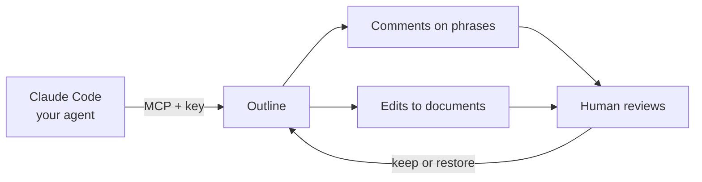

# Use case 2: Your Claude Code agent proposes changes, a human reviews them

**Scenario:** the `Release process` document (from use case 1) is vague and has risky steps. You connect your own Claude Code to Outline through MCP, let it propose improvements, and review them before trusting them.

**Goal:** connect Claude Code to **one collection**, control **how much it can change**, and **review** what it did.

**Prerequisite:** use case 1 done. Fictional data only.

> Tested on 2026-11-10 with Outline 1.12.0 and Claude Code in the local setup. Steps marked *not tested* have not been run yet.

## The idea in four lines

1. **Claude Code is the agent.** It connects to Outline through MCP, an address Outline already provides: `http://localhost:3000/mcp`.
2. **The agent acts as an Outline user.** It gets its own account and its own API key, and it can only touch what that account can reach.
3. **The key decides what the agent may do.** Read only, comment, or edit.
4. **A human reviews.** Outline has **no built-in approve/reject** for agent changes. You review through comments, History, or Claude Code's own approval prompt.



## Setup (once)

### 1. Create the agent's account

Outline only creates a user when someone logs in through your login provider.

- **Local evaluation:** add a second user to Dex (for example `agent@example.com`). Its first login creates the Outline user with the **Member** role.
- **Company:** ask IT for a service account in your login provider.

Keep the agent's password in the macOS Keychain, not in files or chat.

### 2. Limit the agent to one collection

A new user can see every collection that gives **All members** access. In the local setup, `Engineering` and `Welcome` both gave "Can edit", so the agent could edit both.

- As an admin, open each collection you want hidden and click **Share**.
- Set **All members** to no access.
- Leave `Engineering` as it is.

Check by logging in as the agent: only `Engineering` should be visible.

### 3. Create the agent's key

1. Log in as the agent.
2. Open **Settings > API & Access** and click **New API key…**
3. Fill in **Name**, **Scopes** and **Expiration** (one week is enough for a test).
4. Copy the key. Outline shows it only once.

Members can create keys by default. Nothing needs to be enabled.

**Scopes** are typed on one line, separated by spaces:

| Goal | Scopes | The agent can |
|---|---|---|
| **Comments only** | `read comments:create` | Read and comment. It cannot edit. |
| **Comments and edit** | `read comments:create /api/documents.update` | Also update documents. *Not tested yet.* |
| **Avoid** | `documents:write` | Also **delete, move and restore** documents. We tested this and those tools appeared. |

Leaving Scopes empty gives the key full access.

### 4. Store the key in the Keychain

```
security add-generic-password -U -a agent@example.com -s outline-local-agent-key -w
```

It asks for the value, so the key never appears in your shell history.

### 5. Connect Claude Code

1. Make an empty folder for the agent, for example `agent-sandbox`.
2. Inside, create `.mcp.json`. It contains a placeholder, not the key:
   ```json
   {
     "mcpServers": {
       "outline-agent": {
         "type": "http",
         "url": "http://localhost:3000/mcp",
         "headers": { "Authorization": "Bearer ${OUTLINE_AGENT_KEY}" }
       }
     }
   }
   ```
3. Start Claude Code from that folder, loading **only** this server:
   ```
   OUTLINE_AGENT_KEY="$(security find-generic-password -a agent@example.com -s outline-local-agent-key -w)" claude --strict-mcp-config --mcp-config .mcp.json
   ```
4. Ask "What Outline tools do you have?"

**Why the extra flags:** without them, a session in that folder also loads all your other MCP servers (Confluence, Docker, Playwright and so on), and the agent would get far more than Outline. With them, it sees only Outline's tools.

## Three ways for the agent to propose

### A. Comments on exact phrases (safest, nothing changes)

Use the comments-only key and ask:

> Read the "Release process" document in the Engineering collection. Find steps that are vague, risky or missing. For each problem, leave a comment anchored to that exact sentence, explaining the problem and suggesting better wording. Do not edit anything.

The agent attaches each comment to the exact words, so Outline highlights them. If the phrase isn't found, Outline rejects the comment instead of posting it loosely. You read each comment and apply the ones you agree with.

### B. Claude Code asks before every write (*not tested*)

Use the edit key, but don't pre-approve the update tool. Claude Code then asks you before each write and shows what the agent wants to write. You answer yes or no. You see the new text, but not a side-by-side difference.

### C. The agent edits, you review afterwards

Use the edit key and ask:

> Improve the "Release process" document: make each step specific and testable, add a rollback step, and avoid Friday-afternoon production deploys. Keep the numbered format. Tell me what you changed.

The change is **live immediately**. You review in History.

## How the human reviews

1. Log in as an admin or member and open the document.
2. **Comments:** each one appears beside its highlighted phrase. Resolve it once handled.
3. **Edits:** open **History**, turn on **Highlight changes**, and use **Compare to** to see what changed and who changed it. The agent's name appears on its version.
4. To undo, select an earlier version and **Restore**.

## What we saw when we tested it

| Run | Result |
|---|---|
| Comments only | 5 comments, each on one sentence. The text was untouched. |
| Edit | The document went from 5 to 7 steps: a post-deploy check, a rollback, a ticket-based approval and no Friday deploys. |
| One targeted comment | A single comment on "at least 30 minutes", visible as a highlight. |

## Things to watch for

- **Make a copy before an agent edits.** Outline does not save a version of every state. In our test there was **no saved version of the five original steps**, so Restore could not bring them back. Use the document's `⋯` menu and choose **Duplicate** first.
- **Edits remove old comment highlights.** When the agent rewrites a sentence, comments on it keep their text but lose the highlight. Comment after the edit, or keep edits small.
- **The agent invents details.** It added "15 minutes" and "30 minutes" on its own. Review numbers, names and thresholds, not only wording.
- **The key controls everything.** Scopes decide the tools. Don't give an agent more than it needs.
- **Short expiry.** Use a one-week key for tests and revoke it afterwards.
- **Search:** words an agent writes through the API are searchable, but words typed by a person in the editor were not found by Outline's search in our setup. Don't use search alone to check that a human edit was saved.

## If you want a real "propose, then approve"

Outline has no built-in way to hold a change until someone accepts it. Two options:

- **Proposals collection:** give the agent edit access to a separate `Proposals` collection only. It writes its version there, and a human copies the good parts into the real document.
- **Approval gate outside Outline:** a small script fetches the document, lets the agent propose a new version, shows you the difference, and calls Outline only after you approve. This is the same pattern as the `guardian-agent` lab.

## Check yourself

- Why does the agent need its own account? (Everything in Outline is done as a user. A separate account makes its work visible and its access limitable.)
- Why use `--strict-mcp-config`? (So the agent loads only Outline, not all your other MCP servers.)
- The agent's edit looks wrong. What do you do? (Restore an earlier version, if one exists. That is why you duplicate first.)
- Is there a built-in approve/reject for agent edits? (No. Use comments, Claude Code's approval prompt, a Proposals collection, or an approval gate.)
