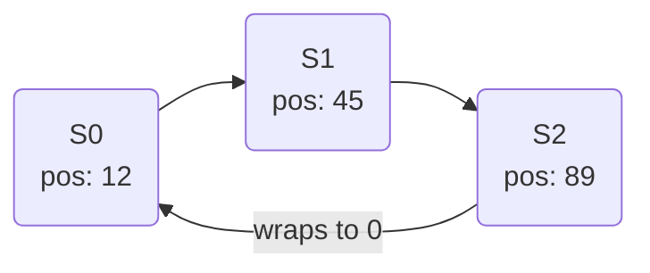
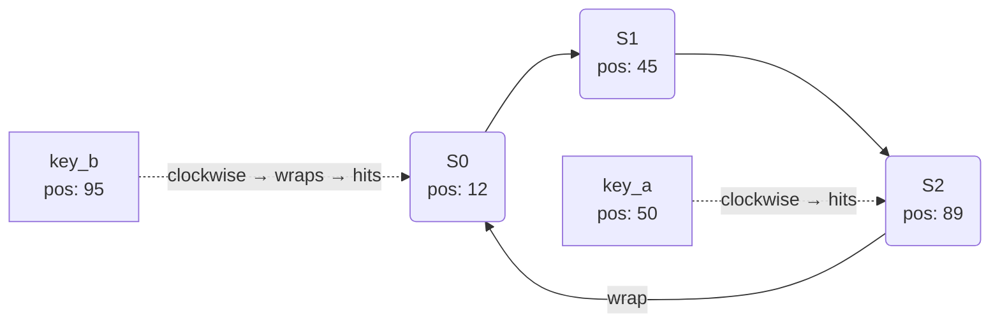
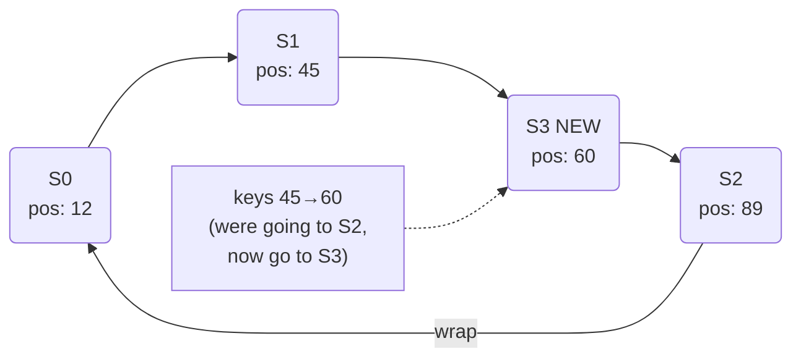
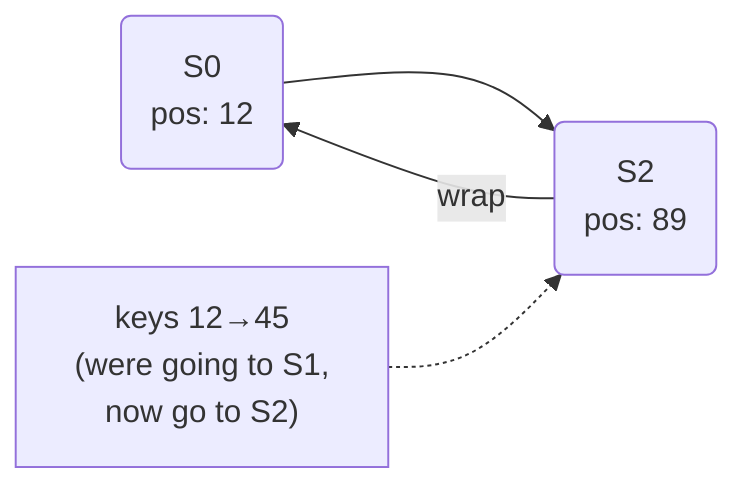
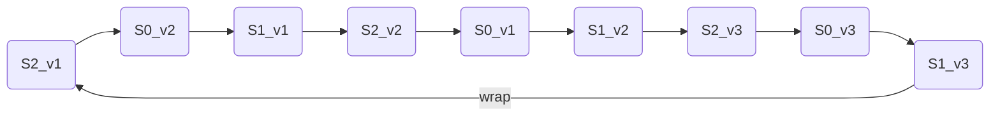

# Consistent Hashing

## What it is

A technique for distributing keys across servers so that adding or removing a server only reassigns a small fraction of keys — not a global reshuffle.

## What problem it solves

Normal hashing (`serverIndex = hash(key) % N`) breaks when N changes. If you add or remove one server, almost every key gets reassigned to a different server, causing a wave of cache misses and database overload. Consistent hashing limits the damage to only the keys near the changed server.

## Notes

### Why normal hashing fails

With 3 servers the formula is `hash(key) % 3`. With 4 servers it becomes `hash(key) % 4`. The modulus changes, so most keys land on a different server:

```
hash("user_1") = 10
  10 % 3 = 1  → S1
  10 % 4 = 2  → S2   ← moved
```

In a cache cluster, every moved key is a cache miss. With thousands of keys that means a sudden spike of traffic hitting the database.

---

### The hash ring

A hash function like SHA-1 maps any input to a number between `0` and `2^160 - 1`. Treat that range as a number line that **wraps around** — after the maximum, it goes back to 0. That wrap is the "ring". It is not a physical structure; it is just a number range with defined wrap-around behavior.

Both servers and keys are hashed onto this same range using the same function:



To find which server owns a key: take the key's hash position and move **clockwise** (increasing values) until you hit a server.



---

### How the lookup works in practice — O(log N)

You do not literally walk the ring step by step. You store all server positions in a **sorted array** and do a **binary search**:

```
servers = [12, 45, 89]   ← sorted positions of S0, S1, S2

key at position 50 → binary search: first position >= 50 → 89 → S2  ✓
key at position 95 → binary search: first position >= 95 → none → wrap → S0  ✓
key at position 10 → binary search: first position >= 10 → 12 → S0  ✓
```

With 1000 servers that is ~10 comparisons. The ring is a mental model; the implementation is a sorted list.

---

### Adding a server

Add S3 at position 60:



Only the keys between S1 (predecessor) and S3 (new server) are reassigned. Everything else stays where it is.

---

### Removing a server

Remove S1 (at position 45):



Only the keys that were assigned to S1 move. They go to S2 (next clockwise). Everything else is untouched.

---

### Problem: uneven distribution

If server hash positions cluster on one side of the ring, one server ends up responsible for most keys:

```
0 ──── S0(5) ── S1(8) ── S2(9) ──────────────────────── 100
       small gaps               huge gap → S0 gets most keys
```

S0 becomes a **hotspot**.

---

### Solution: virtual nodes

Each physical server is hashed multiple times with different inputs, placing many **virtual nodes** on the ring:

```
S0_v1, S0_v2, S0_v3
S1_v1, S1_v2, S1_v3
S2_v1, S2_v2, S2_v3
```



More virtual nodes = more evenly spread positions = more balanced load. The tradeoff: more memory to store the sorted position list.

Apache Cassandra uses 256 virtual nodes per server by default.

---

### Affected keys — precise rule

| Event | Counter-clockwise from changed node until predecessor | Those keys reassigned to… |
|---|---|---|
| Add S_new | predecessor → S_new | S_new |
| Remove S_old | predecessor → S_old | next server clockwise after S_old |

---

### Benefits

- **Minimized redistribution** — only O(K/N) keys move when a server is added or removed (K = total keys, N = servers).
- **Horizontal scaling** — nodes can be added or removed without global reshuffling.
- **Hotspot mitigation** — virtual nodes even out the load.

---

### Real-world users

| System | Use |
|---|---|
| Amazon DynamoDB | Partition key distribution across storage nodes |
| Apache Cassandra | Token ring — each node owns a token range |
| Discord | Message routing across chat servers |
| Akamai CDN | Routing requests to edge cache nodes |
| Maglev (Google) | Load balancing across backend servers |

## Relations

- [[rate-limiter]] — rate limiters in distributed environments face the same server-addition problem; consistent hashing is one way to route requests to the right counter node
- [[cap-and-pacelc]] — consistent hashing enables horizontal scaling but adds eventual consistency challenges when nodes hold replicated data

## Tags

#system-design
