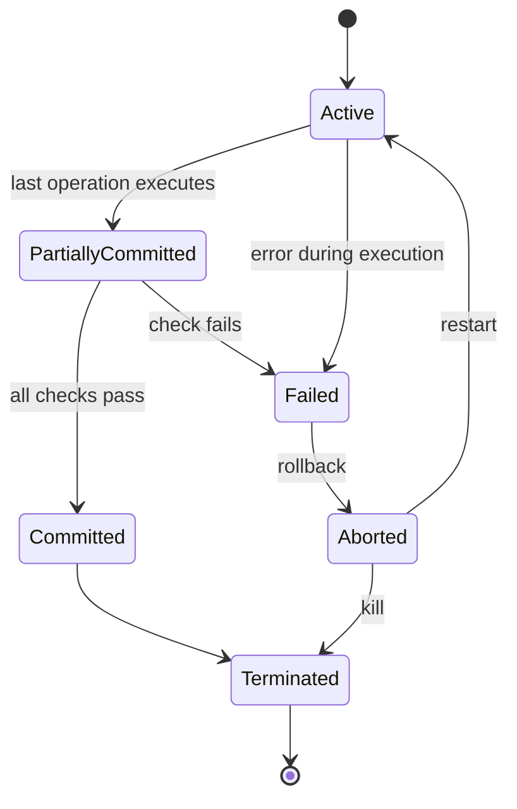
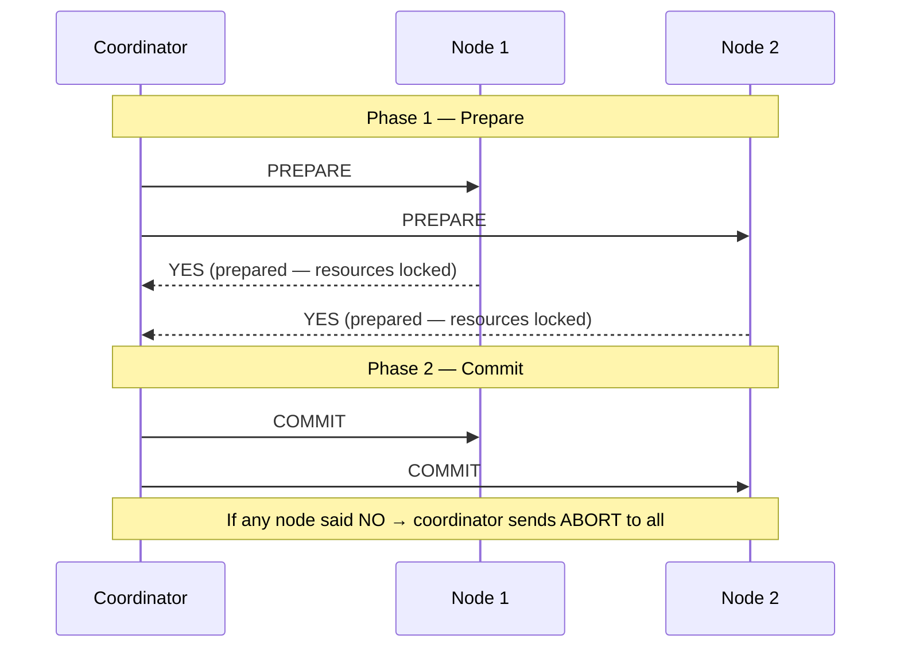
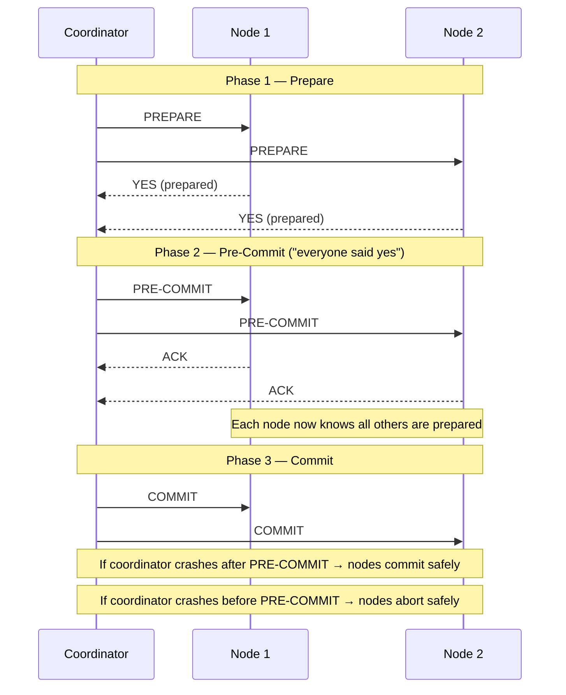

# Distributed Transactions

## What it is

A **transaction** is a series of database operations treated as a single unit of work — they all succeed, or they all fail. A **distributed transaction** is the same concept applied across multiple databases or nodes connected by a network.

## What problem it solves

When data lives in one database, ACID transactions handle everything automatically. When data is split across multiple databases (e.g. separate services each with their own DB), a single `BEGIN / COMMIT` no longer works. You need a mechanism to ensure all nodes commit or all nodes abort — otherwise partial failures leave the system in an inconsistent state.

## Notes

### Transaction states (single database)

These are the lifecycle states a transaction moves through inside one database:

| State | Meaning |
|---|---|
| **Active** | The transaction is executing. Every transaction starts here. |
| **Partially Committed** | The last operation has executed. The transaction is ready to commit but hasn't yet. |
| **Committed** | All operations succeeded and changes are permanently written. |
| **Failed** | A check failed. The transaction can no longer proceed. |
| **Aborted** | The database rolled back all changes. The DB is restored to its pre-transaction state. |
| **Terminated** | Final state. The transaction is done — either committed or aborted. |

After abort, the database can restart the transaction or kill it entirely.

### Why distributed transactions are harder

In a single database, the DB engine coordinates everything internally. In a distributed system, multiple independent nodes must agree on whether to commit or abort — and any of them can fail at any moment.

The core requirement: **all nodes commit, or all nodes abort**. There is no partial outcome.

### Solution 1 — Two-Phase Commit (2PC)

A coordinator node orchestrates the transaction across all participant nodes in two phases:

**Phase 1 — Prepare**
1. Coordinator asks all nodes: "can you commit?"
2. Each node runs the transaction locally, locks resources, writes to its WAL (so it can survive a crash)
3. Each node replies: "yes, prepared" or "no, abort"

**Phase 2 — Commit**
1. If all said yes → coordinator tells everyone: "commit"
2. If any said no → coordinator tells everyone: "abort"

A node that replies "prepared" is in the **partially committed** state — it has done all the work and is just waiting for the coordinator's signal.

**Problems with 2PC:**

| Problem | What happens |
|---|---|
| A node crashes after saying "prepared" | Coordinator times out → aborts → safe. But if coordinator already sent "commit" to others → inconsistency. |
| Coordinator crashes after "prepare", before "commit" | Nodes are frozen — they replied "prepared", locked resources, and are waiting. They can't safely commit or abort alone. They wait indefinitely. |
| It is a blocking protocol | A prepared node surrendered its autonomy. If the coordinator never recovers, that node's resources stay locked forever. |

### Solution 2 — Three-Phase Commit (3PC)

3PC adds one phase between prepare and commit: **pre-commit**.

**The insight:** the pre-commit message means "the coordinator confirmed that every node said yes." A node that receives pre-commit now knows a new fact: all other participants are prepared.

This breaks the 2PC deadlock:

| Node state when coordinator crashes | 2PC | 3PC |
|---|---|---|
| Waiting for pre-commit (hasn't received it) | Stuck | **Safe to abort** — coordinator died before everyone confirmed |
| Received pre-commit | Stuck | **Safe to commit** — knows everyone was prepared |

In 3PC, every phase can time out and resolve safely. No indefinite blocking.

**Trade-off:** one extra network round-trip on every transaction. Still breaks under network partitions. Rarely used in practice.

## Relations

- [[acid-and-base]] — ACID transactions are what a single database provides. Distributed transactions exist because ACID doesn't span multiple nodes automatically.
- [[cap-and-pacelc]] — 2PC is a CP protocol: it blocks (becomes unavailable) rather than risk inconsistency. Sagas accept eventual consistency — they're AP by design.

## Tags

#system-design
