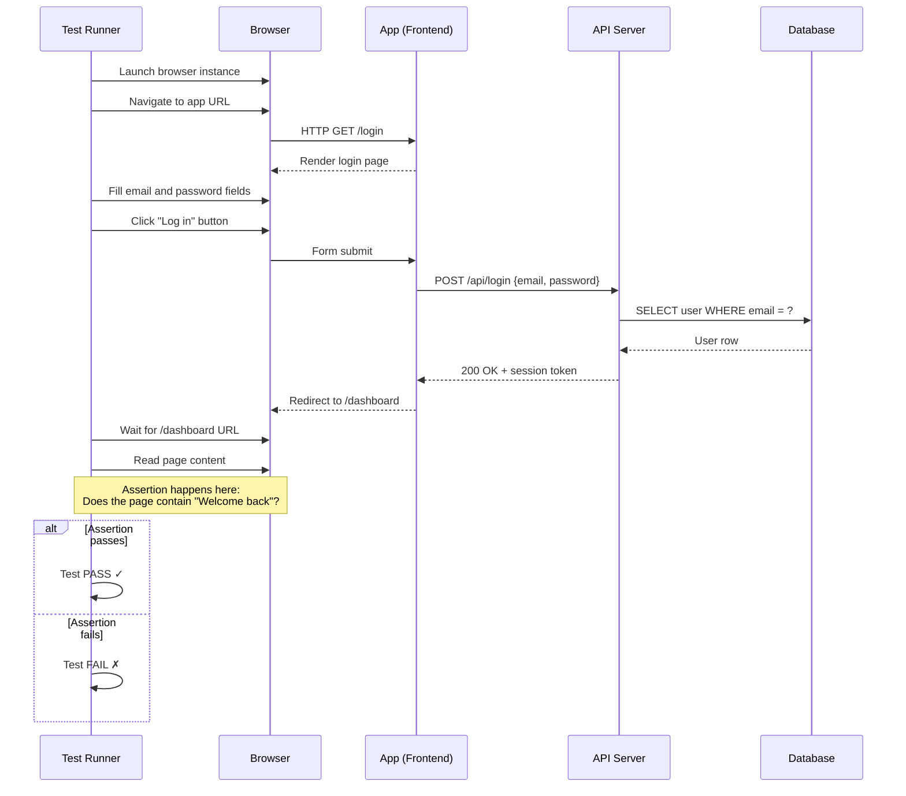

# End-to-End Testing

## What it is

Tests that simulate a real user interacting with the complete, deployed system. An e2e test opens a real browser, clicks real buttons, fills real forms, and asserts that the right things appear on screen — while the app talks to real APIs, real databases, and real services behind it.

## What problem it solves

Unit and integration tests verify pieces in isolation. But a system can have all pieces working individually and still fail when assembled — wrong API contract, misconfigured routing, broken CSS that hides a button, a database migration that wasn't applied. E2e tests catch these "works on my machine, breaks in production" failures.

## Notes

### How they actually work — the mechanics

An e2e test is a script that drives a real browser programmatically. Here's what happens under the hood:

```
1. Test runner launches a real browser (Chrome, Firefox)
2. Browser navigates to the app's URL
3. Script finds elements on the page (by CSS selector, test ID, role)
4. Script performs actions: click, type, scroll, wait
5. Script asserts: "this text should appear", "this URL should change", "this element should be visible"
6. If any assertion fails → test fails
```



Example — testing a login flow (pseudocode):

```
test("user can log in and see dashboard") {
    go to "/login"
    fill "#email" with "test@example.com"
    fill "#password" with "secure123"
    click "Log in" button
    wait for URL to be "/dashboard"
    assert page contains "Welcome back"
}
```

This is NOT an API call. The test literally opens Chrome, types into input fields, clicks buttons, and reads what appears on screen — exactly like a human would.

### What to test with e2e

Test the **critical user journeys** — the paths that, if broken, would mean the business loses money or users can't do their job:

- Can a user sign up, log in, and reach the main screen?
- Can a user complete a purchase from start to finish?
- Can a user create, edit, and delete the core entity?

Do NOT test edge cases with e2e. Edge cases belong in unit tests (fast, cheap, reliable). E2e tests answer: "does the happy path work when everything is wired together?"

### Common tools

| Tool | Language | Key trait |
|---|---|---|
| **Playwright** | JS/TS, Python, Java, .NET | Multi-browser, auto-waits, modern API, Microsoft-backed |
| **Cypress** | JS/TS | Runs inside the browser, great DevEx, single-domain |
| **Selenium** | Many | The original, widest browser support, more verbose |

### Why they are slow

Each test must:
1. Start a browser (expensive)
2. Navigate to a real page (network request)
3. Wait for the page to render (DOM + assets + API calls)
4. Perform each action sequentially (can't click before the button exists)
5. Clean up state (log out, reset data)

A unit test runs in 5ms. An e2e test runs in 5–30 seconds. Multiply by 200 tests and CI takes an hour.

### Why they are flaky

"Flaky" = fails sometimes, passes other times, with no code change. Causes:

- **Timing**: the test clicks a button before it's rendered. The page was 50ms slower today because the server was busy.
- **Test data**: test assumes a user exists in the database, but a previous test deleted it.
- **External dependencies**: a third-party API is slow or returns different data.
- **Animations/transitions**: the test reads text while a CSS animation is still moving.
- **Shared state**: two tests run in parallel and modify the same database row.

This is why e2e tests need explicit waits ("wait until this element appears") rather than fixed sleeps, and why test data setup/teardown is critical.

### Why they are expensive to maintain

- A designer changes a button label from "Submit" to "Continue" → every test that clicks "Submit" breaks.
- A new required field is added to a form → every test that fills that form needs updating.
- The app's URL structure changes → navigation steps break.

E2e tests are tightly coupled to the UI. Any UI change can cascade into many test failures, even if the behavior is correct.

### Best practices

1. **Use data-testid attributes** — don't select by CSS class or text content (these change often). Select by `data-testid="login-button"`.
2. **Test only critical paths** — 5-10 e2e tests are better than 200 flaky ones.
3. **Isolate test data** — each test creates its own users/data, never depends on shared state.
4. **Run in CI, not locally** — e2e tests need a deployed environment. Don't make developers run them on every change.

## Quiz

**1.** A junior developer writes an "e2e test" that calls `POST /api/login` with a requests library and checks the JSON response. Is this an e2e test?

- a) No — it's an integration test. A real e2e test would open a browser, type credentials into the form, click the login button, and check the dashboard loads
- b) No — it's a unit test because it only tests one endpoint
- c) Yes — it tests the real login endpoint
- d) I don't know

**2.** Your e2e test passes 9/10 times. The 10th run, it fails with "element not found" on the Submit button. No code changed. What's the fix?

- a) The test framework has a bug — switch to a different tool
- b) Add `sleep(3)` before clicking to give the page time to load
- c) Use an explicit wait — "wait until the Submit button is visible/clickable, then click." This adapts to actual page speed instead of guessing with a fixed delay
- d) I don't know

**3.** The design team renames a button from "Submit" to "Continue" and changes its CSS class. Five e2e tests break, but the app's behavior didn't change. What would have prevented this?

- a) Making designers check with QA before renaming anything
- b) Writing fewer e2e tests so there are fewer things to break
- c) Using `data-testid="submit-btn"` attributes to find elements — these are stable test anchors that don't change when designers update text or styling
- d) I don't know

**4.** Your PM asks for e2e tests for: (a) happy-path checkout, (b) wrong password error, (c) expired session redirect, (d) concurrent editing. Which belong as e2e tests?

- a) (a) and (d) — checkout and concurrency are complex flows that need browser testing
- b) All four — e2e should cover everything important
- c) Only (a) — the happy-path checkout. The others are edge cases that belong as unit or integration tests, where they're faster and more reliable
- d) I don't know

**5.** You have 150 e2e tests, CI takes 50 minutes, and every other run has random failures. Developers start ignoring test results. What do you do?

- a) Keep the 5-10 critical path tests, delete or move the rest to integration/unit level. Fix the remaining flaky tests. A small, reliable suite is better than a large, ignored one
- b) Add more CI machines to run tests faster in parallel
- c) Add retries — if a test fails, run it again automatically to filter out flaky results
- d) I don't know

## Relations

- [[test-pyramid]] — e2e sits at the top of the pyramid: few tests, high confidence, high cost
- [[unit-testing]] — the base layer: fast, isolated, where edge cases belong instead of e2e
- [[smoke-testing]] — smoke tests are a small, fast subset of e2e used specifically after deployment
- [[integration-testing]] — the layer below e2e, where you test component interactions without a full browser
- [[flakiness]] — flakiness is the #1 reason teams abandon e2e suites

## Tags

#testing
