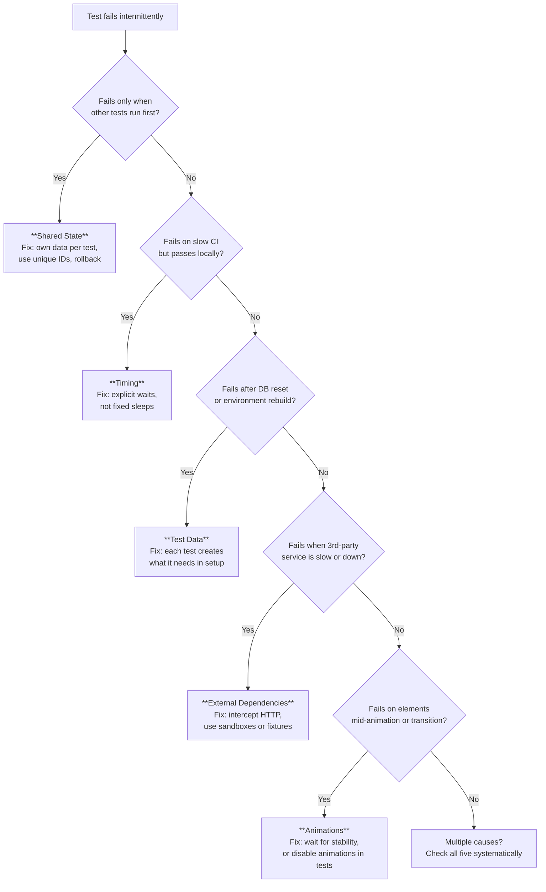

# Flakiness

## What it is

A flaky test is one that fails sometimes and passes other times with no code change. The same commit, the same test, different results. It's non-determinism in the test suite.

## What problem it solves

Understanding flakiness solves it. Teams that can't diagnose flakiness either add retries (hiding real bugs) or stop trusting the suite entirely (ignoring real failures). Knowing the five causes lets you prevent flakiness at design time instead of chasing it at debug time.

## Notes

### The five causes

Every flaky test traces back to one of these five root causes. They're ordered from most to least common.



### 1. Timing

The test assumes something will be ready by the time it checks, but the timing is non-deterministic.

```
click "Submit"
assert page contains "Order confirmed"   // FLAKY — the page hasn't rendered yet
```

The server took 200ms today instead of 50ms. The test ran faster than the UI. The assertion fires before the result appears.

**Why it happens:** networks, servers, and rendering pipelines have variable latency. A test that passes on a fast machine fails on a loaded CI runner.

**The fix:** explicit waits, not fixed sleeps. "Wait until this element is visible, then assert" adapts to actual speed. `sleep(3)` either wastes time (too long) or still flakes (too short).

```
click "Submit"
wait until "Order confirmed" is visible    // STABLE — adapts to actual rendering time
assert page contains "Order confirmed"
```

### 2. Shared state

Two tests touch the same data and interfere with each other. The outcome depends on which test runs first — or whether they run in parallel.

```
Test A: creates user "alice@test.com"
Test B: creates user "alice@test.com"   // FLAKY — fails if A runs first (duplicate key)
```

Or worse:

```
Test A: deletes all users
Test B: asserts user count is 5         // FLAKY — fails if A runs before B
```

**Why it happens:** tests share a database, a file, a cache, or a global variable. Running tests in parallel or in a different order exposes the coupling.

**The fix:** each test creates and owns its own data. Use unique identifiers (UUIDs, timestamps) instead of hardcoded values. Clean up in teardown, or better: use transactions that roll back.

### 3. Test data

The test depends on data that existed when it was written but no longer does — or data created by another test that may or may not have run yet.

```
test("show user profile") {
    go to "/users/42"                    // FLAKY — user 42 may not exist
    assert page contains "Alice"
}
```

This is different from shared state: the problem isn't two tests fighting over data, it's one test assuming data is there without creating it.

**Why it happens:** test environments get reset, migrations run, seed data changes, or someone manually modified the test database.

**The fix:** each test sets up exactly the data it needs in its own setup phase. Never rely on pre-existing data. If the test needs user 42, it creates user 42.

### 4. External dependencies

The test calls a real third-party service that is slow, rate-limited, down, or returns different data than expected.

```
test("show weather widget") {
    go to "/dashboard"
    assert weather widget shows temperature    // FLAKY — weather API might be down, slow, or return different data
}
```

**Why it happens:** third-party APIs are outside your control. They have outages, latency spikes, rate limits, and data that changes constantly.

**The fix:** at the e2e level, use the provider's sandbox/test environment when available. When not available, intercept the network call and return a fixture. The key distinction: this is not the same as mocking in a unit test. You're intercepting at the HTTP boundary, not replacing the code that calls the API.

### 5. Animations and transitions

The test reads or interacts with an element while a CSS animation, transition, or JavaScript-driven motion is in progress.

```
click "Delete"
// confirmation dialog slides in with a 300ms animation
click "Confirm"           // FLAKY — button exists in DOM but is mid-animation and not clickable yet
```

Or:

```
assert text is "Order #1234"   // FLAKY — a fade-in animation hasn't finished, text reads as empty
```

**Why it happens:** modern UIs use animations everywhere. The DOM element exists before the animation completes, but it may not be interactive or its content may not be rendered yet.

**The fix:** wait for the element to be stable (not just present). Playwright's `waitForSelector` with `state: 'visible'` handles this. Some teams disable animations entirely in the test environment via CSS (`* { animation: none !important; transition: none !important; }`).

### How they compound

In practice, flaky tests often combine multiple causes. A test that relies on shared state AND has timing issues will be nearly impossible to diagnose if you only look for one cause. Debug flakiness by checking all five causes systematically.

### The retries trap

Adding automatic retries (re-run failed tests 3 times) hides flakiness instead of fixing it. Retries:
- Slow down CI (a 5-second test retried 3 times is 15 seconds)
- Mask real bugs (if a retry passes, the failure is silently ignored)
- Erode trust gradually (the team knows the suite "needs" retries to pass)

Retries are a temporary band-aid while you fix the root cause. They should never be permanent.

## Quiz

**1.** A test creates a user with email "test@example.com" and asserts the user appears in a list. It passes alone but fails when run after another test. What's the most likely cause?

- a) Timing — the page hasn't loaded yet
- b) Shared state — the other test also uses "test@example.com" and the duplicate key conflicts
- c) External dependencies — the email validation service is down
- d) I don't know

**2.** Your e2e test clicks "Save" and immediately checks for a success message. It passes 9/10 times. A colleague suggests adding `sleep(2)`. What's wrong with that approach?

- a) Nothing — sleep(2) gives the server enough time to respond
- b) It's a guess. If the server takes 2.5s, it still flakes. If it takes 200ms, you waste 1.8s per test. Use an explicit wait that adapts to actual speed
- c) Sleep is fine for CI but not for local development
- d) I don't know

**3.** A test navigates to `/dashboard`, which shows real-time stock prices from a third-party API. The test passes in the morning but fails at night. What cause is this?

- a) Timing — the server is slower at night
- b) External dependency — the stock API returns different data (or is down) at different times
- c) Shared state — someone else is modifying the dashboard
- d) I don't know

**4.** Your team disables all CSS animations in the test environment and suddenly three previously flaky tests become stable. Which cause did this fix?

- a) Timing
- b) Animations/transitions — elements were being read mid-animation, causing intermittent failures
- c) External dependencies
- d) I don't know

**5.** A test relies on a seed user "admin" existing in the database. It passes for months, then starts failing after a database migration resets the test environment. What's the root cause category?

- a) Test data — the test assumed pre-existing data instead of creating what it needs
- b) Shared state — the migration is a form of shared state
- c) External dependency — the database migration is external to the test
- d) I don't know

## Relations

- [[end-to-end-testing]] — flakiness is the #1 reason teams abandon e2e suites
- [[integration-testing]] — integration tests can also be flaky (shared state, test data), but less often than e2e
- [[test-pyramid]] — flakiness cost increases as you move up the pyramid
- [[smoke-testing]] — smoke tests must be zero-flake because they're deployment gates

## Tags

#testing
