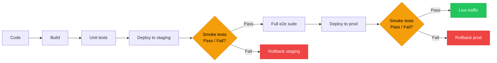

# Smoke Testing

## What it is

A small, fast subset of tests run immediately after a deployment to verify the system is alive and its most basic functions work. The name comes from electronics: plug it in, turn it on, and see if smoke comes out. If it smokes, don't bother testing anything else.

## What problem it solves

After deploying to an environment (staging, production), you need a quick answer: "did we break something fundamental?" You don't want to wait 30 minutes for the full e2e suite. Smoke tests answer in 1-2 minutes whether the deployment is viable or should be rolled back immediately.

## Notes

### Smoke test vs. e2e test — the key distinction

This is the most common confusion. They are NOT the same thing:

| Aspect | Smoke test | E2E test |
|---|---|---|
| **Purpose** | "Is the system alive?" | "Does the user journey work correctly?" |
| **Depth** | Shallow — checks surface-level health | Deep — exercises complete flows step by step |
| **Quantity** | 5-15 checks | 50-200+ tests |
| **Speed** | 1-2 minutes total | 15-60 minutes total |
| **When to run** | After every deployment | On a schedule or before release |
| **What failure means** | "Roll back NOW, something fundamental is broken" | "There's a bug in this specific flow" |

### What smoke tests check

- Can the application start and respond to HTTP requests? (health endpoint returns 200)
- Can it connect to the database? (a simple query succeeds)
- Can it reach external services it depends on? (payment gateway, email service)
- Does the login page load?
- Can a user log in with valid credentials?
- Does the home page / dashboard render without errors?

### What smoke tests deliberately skip

- Edge cases (wrong password, expired session, concurrent users)
- Complete flows (they check "login works" but NOT "login → navigate → edit profile → save → verify")
- Performance (response time, load capacity)
- Visual correctness (layout, styling, responsiveness)
- Data validation (form rules, error messages)

### The analogy

Think of buying a used car:
- **Smoke test**: turn the key → engine starts → lights work → brakes respond. Takes 2 minutes. If any of these fail, you walk away.
- **E2e test**: drive it for an hour on highways and city streets, test AC, radio, parallel parking, hill starts. Takes time, but you discover subtle problems.

You always smoke test first. If smoke fails, there's no point running the full suite.

### Where smoke tests fit in a deployment pipeline

Smoke tests act as **deployment gates**. They run fast and fail fast. If smoke tests fail after deploying to staging, the pipeline stops — no point running the expensive e2e suite on a broken environment.

### Smoke tests are NOT a test type

This is subtle but important: smoke testing is a **strategy**, not a layer in the test pyramid. A smoke test is typically a carefully selected subset of existing e2e or integration tests — the ones that cover the most critical "is it alive?" checks. You don't write separate "smoke test code"; you tag or group existing tests and run only those after deployment.

## Quiz

**1.** You just deployed to production. You can run 8 quick checks in 90 seconds or the full 200-test e2e suite in 45 minutes. What do you do?

- a) Skip both — if the code passed tests before deployment, it will work in production
- b) Run the 8 quick checks first. If they fail, roll back immediately — don't wait 45 minutes to discover the deployment is fundamentally broken. Run the full suite afterward or in parallel
- c) Run the full e2e suite — you need complete confidence before users hit the new code
- d) I don't know

**2.** A colleague writes 50 "smoke tests" covering form validation rules, error messages, and edge cases. What's wrong?

- a) Smoke tests should be 5-15 shallow checks that answer "is the system alive?" (health endpoint, DB connection, login works). Form validation edge cases belong in unit tests. 50 checks defeats the purpose — smoke must be fast
- b) 50 is too few — smoke should cover every user flow
- c) Nothing — thorough smoke testing prevents production bugs
- d) I don't know

**3.** Your smoke suite checks: (a) health endpoint returns 200, (b) login page loads, (c) DB connection works, (d) full 7-step checkout with coupons and shipping. One doesn't belong. Which?

- a) (b) — login is too complex for smoke testing
- b) (a) — health endpoints are infrastructure, not smoke testing
- c) (d) — a 7-step checkout flow is deep e2e testing, not smoke. Smoke checks surface-level health, not complete user journeys
- d) I don't know

**4.** Smoke tests pass after deploying to staging. 30 minutes later, the full e2e suite fails. Are the smoke tests useless?

- a) No — smoke and e2e have different jobs. Smoke confirmed the deployment didn't break anything fundamental (app starts, DB connects, login works). The e2e failure is a deeper bug in a specific flow. Smoke did its job: it told you the system is alive, so the full suite is worth running
- b) It means the smoke tests need more coverage to match the e2e suite
- c) Yes — they should have caught what the e2e suite found
- d) I don't know

**5.** A teammate says "smoke testing is just e2e testing with fewer tests." Is this accurate?

- a) No — smoke tests and e2e tests use completely different tools and techniques
- b) Yes — smoke tests are a subset of e2e tests, same technique just fewer
- c) Partially — smoke tests often reuse e2e test mechanics, but the distinction is PURPOSE. E2e asks "does this flow work correctly?" Smoke asks "is the system alive enough to bother testing?" Smoke is a deployment gate, not a quality check
- d) I don't know

## Relations

- [[end-to-end-testing]] — smoke tests are a curated subset of e2e tests, optimized for speed
- [[test-pyramid]] — smoke testing is a strategy that cuts across the pyramid, not a layer in it
- [[integration-testing]] — some smoke tests may be integration-level (e.g. "can the app reach the database?")

## Tags

#testing
