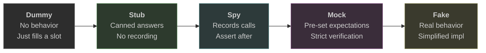

# Test Doubles

## What it is

Test doubles are stand-in objects that replace real dependencies during testing. The term comes from "stunt double" in film — a replacement that looks like the real thing but is controlled by the director. Just as a stunt double lets you shoot a dangerous scene without risking the lead actor, a test double lets you exercise your code without needing a real database, network, or third-party service.

"Test double" is the umbrella term. "Mock" is just one specific type — and the most overused one.

## What problem it solves

Real dependencies make tests slow, unpredictable, and hard to set up. A test that hits a real database needs that database running, seeded with data, and cleaned up afterward. A test that calls an external API depends on network availability and the service being up. A test that sends real emails... sends real emails.

Test doubles remove these obstacles by giving you controlled replacements. They let you:

- Test a single unit in isolation, without dragging in the rest of the system
- Control exactly what inputs your code receives (including error cases that are hard to trigger with real dependencies)
- Run tests in milliseconds instead of seconds
- Run tests anywhere, with no infrastructure requirements

## Notes

### The taxonomy

"Mock" has become a catch-all term, but there are five distinct types of test doubles. Each serves a different purpose. Using the wrong type leads to either fragile tests or insufficient coverage.

| Type | What it does | Example |
|---|---|---|
| **Dummy** | Passed but never actually used — fills a required parameter | An empty logger passed to satisfy a constructor signature |
| **Stub** | Returns pre-configured answers to calls made during the test | `getPrice()` always returns 9.99 regardless of product |
| **Spy** | Records what happened — you assert on the recording after the fact | "Was `sendEmail()` called exactly once with this address?" |
| **Mock** | Pre-programmed with expectations — fails immediately if not called correctly | Expects `save(user)` with specific args; fails the test if called with different args or not called at all |
| **Fake** | A working implementation, but simplified for testing purposes | An in-memory database instead of PostgreSQL; a local file store instead of S3 |

The differences are subtle but consequential. A stub doesn't care how many times you call it — it just answers. A mock is strict: call it wrong and the test fails. A spy sits in between — it records everything and lets you decide what to assert afterward.

### The key distinction: state vs. behavior verification

This is the single most important concept for choosing the right test double:

- **State verification** (stubs + assert on output): you call the code, then check what the result is. You test WHAT happened.
- **Behavior verification** (mocks + assert on calls): you set expectations on how dependencies are called, then run the code. You test HOW it happened.

```
// Estado: verificacion por estado — con stub
priceService = stub(getPrice -> 9.99)
cart = ShoppingCart(priceService)
cart.addItem("widget")
assert cart.total() == 9.99     // solo nos importa el resultado

// Comportamiento: verificacion por comportamiento — con mock
repository = mock()
repository.expects(save).withArgs(user).once()
service = UserService(repository)
service.register(user)
repository.verify()             // nos importa que se llamo correctamente
```

State verification is almost always more robust. When you refactor the internals of your code — changing how it achieves the same result — state-based tests keep passing. Behavior-based tests break, because they're coupled to the implementation, not the outcome.

### When each type is appropriate

- **Dummy**: when you don't care about that dependency at all — it exists only because the API demands it.
- **Stub**: when you need controlled input to test your logic. This is the workhorse. Most tests that need a double need a stub.
- **Spy**: when you need to verify a side effect happened (email sent, event published, metric recorded) but you want flexible assertions after the fact.
- **Mock**: when the interaction IS the behavior you're testing — rare. The classic example: verifying that a payment gateway was called with exactly the right amount. Overuse leads to brittle tests.
- **Fake**: when you need realistic behavior but can't use the real thing. A fake database lets you test query logic without a running server. Fakes are more work to build but produce the most resilient tests.

### The over-mocking trap

When every dependency is mocked with strict expectations, your tests become a mirror of your implementation. They pass when the code is written one way and break when you refactor — even if the behavior hasn't changed. This is the over-mocking trap.

Signs you've fallen into it:

- Tests break on every refactor, even when no behavior changed
- Tests pass but bugs still reach production (because the mocks are too far from reality)
- Tests are harder to read than the code they test
- You're testing that method A calls method B, not that the system produces the right outcome

The fix: prefer stubs over mocks. Assert on outputs and state, not on call sequences. Use fakes for complex dependencies. Reserve mocks for cases where the call itself is the behavior you care about.

### The fidelity spectrum

Test doubles form a spectrum from simplest to most realistic:



Moving left to right: complexity increases, but so does confidence. The art is choosing the simplest double that gives you the confidence you need.

## Quiz

**1.** You're testing a `NotificationService` that takes a `Logger` in its constructor. Your test only cares about whether notifications are sent correctly — the logger is irrelevant to this test. What type of test double should you use for the logger?

- a) Stub that returns `null` for every method
- b) Mock that expects no calls
- c) Dummy — an object that satisfies the type but does nothing
- d) I don't know

**2.** You're testing a `ReportGenerator` that fetches data from a `DataWarehouse`. You want to test that the generator correctly formats data into tables. You need the warehouse to return specific datasets so you can verify the formatting logic. What type of test double should you use?

- a) Fake — build a simplified in-memory data warehouse
- b) Stub — configure it to return the exact datasets you need
- c) Mock — set expectations on which queries are made
- d) I don't know

**3.** Your `OrderService.placeOrder()` must publish an `OrderPlaced` event to a message bus after saving the order. You want to verify the event was published with the correct order ID, but you don't want to be strict about the exact sequence of calls. What type of test double should you use for the message bus?

- a) Stub that silently accepts any call
- b) Mock that expects `publish()` with exact arguments in exact order
- c) Spy — let it record all calls, then assert that `publish()` was called with the right order ID
- d) I don't know

**4.** You're testing a service that stores files. The real implementation uses S3, but your tests need to actually read back what was written — not just verify that a method was called. You need the double to behave like a real store. What type of test double fits?

- a) Mock with pre-programmed return values
- b) Spy that records write calls
- c) Stub that returns hardcoded file contents
- d) I don't know

The best answer here is a **Fake** — an in-memory file store that actually stores and retrieves data. None of the listed options fully work, which is the point: when you need real behavior, you need a fake.

**5.** A colleague shows you a test where every dependency is a mock with strict expectations. The test verifies that `processPayment()` calls `validate()`, then `charge()`, then `notify()`, in that exact order, with those exact arguments. The test passes. What is the main risk?

- a) The test is too slow
- b) The test will break on any internal refactor, even if the behavior is unchanged — it tests implementation, not outcome
- c) Mocks cannot verify call order
- d) I don't know

## Relations

- [[unit-testing]] — test doubles are the mechanism that makes unit test isolation possible
- [[integration-testing]] — integration tests deliberately avoid test doubles for the components under test
- [[flakiness]] — over-reliance on mocks can mask real bugs that cause flaky integration/e2e tests

## Tags

#testing
