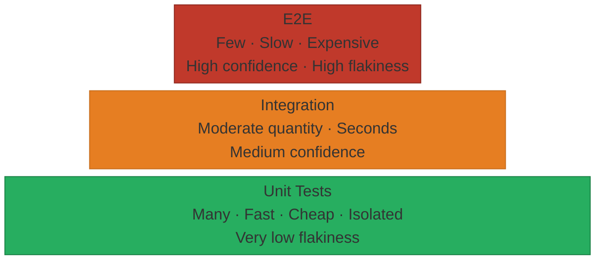
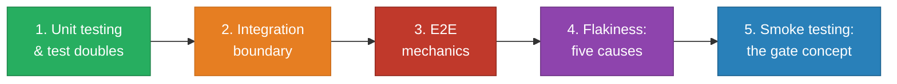

# Test Pyramid

## What it is

A visual metaphor for test strategy, proposed by Mike Cohn. It organizes test types into layers: many fast cheap tests at the base, few slow expensive tests at the top. The shape is a pyramid because the quantity of tests should decrease as you move up.

## What problem it solves

Without a strategy, teams either write too many e2e tests (slow, flaky, expensive CI) or only unit tests (fast but never verify that components work together). The pyramid gives a rule of thumb for balancing the three layers.

## Notes

### The three layers

| Layer | What it tests | Speed | Flakiness | Confidence in real behavior |
|---|---|---|---|---|
| **Unit** | One function/class in isolation, dependencies mocked | Milliseconds | Very low | Low — mocks can hide real bugs |
| **Integration** | Two or more components working together (e.g. service + database) | Seconds | Low-medium | Medium — real interactions, still controlled |
| **E2E** | The full system from the user's perspective | Seconds to minutes | High | High — closest to real usage |

### Key insight

As you go up the pyramid:
- **Cost increases** — slower to run, harder to write, more infrastructure needed
- **Flakiness increases** — more moving parts means more ways to fail for non-bug reasons
- **Confidence increases** — you're testing something closer to what a real user experiences
- **Debugging difficulty increases** — when an e2e test fails, the bug could be anywhere in the stack

### The anti-pattern: ice cream cone

When a project has many e2e tests and few unit tests, the pyramid is inverted. This is called the "ice cream cone" anti-pattern. Symptoms: CI takes 45 minutes, tests fail randomly, developers stop trusting the test suite.

### Practical ratio

There is no universal ratio. A common heuristic: 70% unit, 20% integration, 10% e2e. The important thing is the shape (more at the bottom), not the exact numbers.

## Quiz

**1.** Your team's CI takes 40 minutes and 30% of runs fail randomly with no code changes. The suite is mostly browser-level tests with almost no isolated function tests. What's the problem?

- a) The test framework is buggy and needs replacing
- b) The pyramid is inverted — too many e2e tests, too few unit tests (ice cream cone)
- c) 40 minutes is normal for a mature project — add more CI machines
- d) I don't know

**2.** A colleague wants to delete all unit tests because "the e2e suite already proves the app works." Why is this a bad idea?

- a) Unit tests are faster and more reliable — when an e2e test fails, you can't tell which function broke, so debugging takes hours instead of seconds
- b) Unit tests are required by most compliance frameworks — deleting them is a legal risk
- c) It's actually fine — if e2e tests pass, every piece must be working
- d) I don't know

**3.** Two teams build the same feature. Team A writes 200 e2e tests and 10 unit tests. Team B writes 20 e2e tests and 200 unit tests. Six months later, which team ships faster?

- a) Team A — more e2e tests means higher confidence, so they deploy fearlessly
- b) Team B — their fast, reliable unit tests give quick feedback; their few e2e tests cover the critical paths without the maintenance burden
- c) Same speed — the total number of tests is what matters, not the distribution
- d) I don't know

**4.** You need to add a test for a new edge case: invalid email format shows an error. Where in the pyramid should this test live?

- a) E2e — open a browser, type a bad email, check the error message appears
- b) Unit — test the validation function directly with the bad input
- c) Both — unit test for the logic, e2e test to verify the error message renders
- d) I don't know

**5.** You fix a bug in a pricing function. An e2e test caught it, but it took 2 hours to find WHERE in the stack the bug was. What would have caught it faster?

- a) A faster e2e test framework with better error messages
- b) A unit test for the pricing function — it would have pointed directly to the broken function in milliseconds
- c) More e2e tests covering different pricing scenarios
- d) I don't know

## Learning path

Recommended order for learning the testing domain. Each node builds on the previous — follow them linearly.

| Step | Page | Why it matters |
|------|------|----------------|
| 1 | [[unit-testing]] + [[test-doubles]] | The pyramid's base — isolation, speed, and the mechanisms that make it work |
| 2 | [[integration-testing]] | Where the "mock everything" rule ends — the unit/integration boundary |
| 3 | [[end-to-end-testing]] | Full-system testing mechanics — needed to reason about trade-offs |
| 4 | [[flakiness]] | The #1 reason teams abandon test suites — understanding causes prevents it |
| 5 | [[smoke-testing]] | The deployment gate concept — only clicks after understanding e2e depth and flakiness cost |

## Relations

- [[unit-testing]] — the base layer of the pyramid
- [[test-doubles]] — the mechanisms that enable unit test isolation
- [[end-to-end-testing]] — the top layer of the pyramid
- [[integration-testing]] — the middle layer of the pyramid
- [[smoke-testing]] — a special-purpose subset, not a layer in the pyramid

## Tags

#testing
