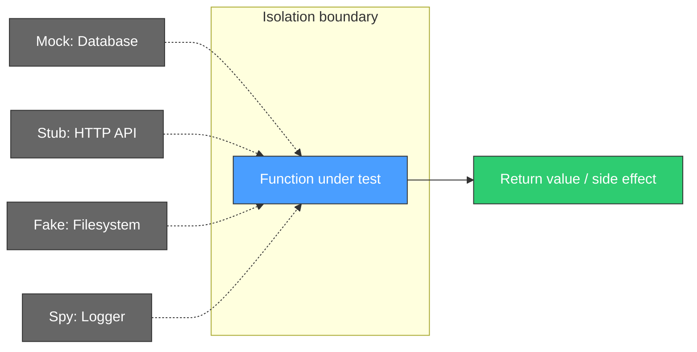

# Unit Testing

## What it is

A test that exercises a single function, method, or class in complete isolation from external dependencies. Every collaborator (database, API, filesystem, clock) is replaced with a test double so the only thing that can fail is the logic under test. Unit tests are the base layer of the [[test-pyramid]]: highest quantity, lowest cost, fastest feedback.

## What problem it solves

Without unit tests, the only way to know if a function works is to run the entire application and manually trigger the code path. That's slow, unrepeatable, and scales terribly. Unit tests give instant, automated proof that individual pieces of logic are correct — before any integration is attempted.

## Notes

### What "isolation" means mechanically

Isolation means the function under test has zero contact with the real world. Every dependency is replaced:

| Real dependency | Replaced with |
|---|---|
| Database | Stub that returns hardcoded data |
| HTTP API | Mock that records calls and returns fake responses |
| Filesystem | In-memory fake |
| Clock / time | Fixed timestamp |
| Random number generator | Seeded or deterministic fake |

If any real infrastructure is involved, it's no longer a unit test — it's an [[integration-testing|integration test]].

### Isolation boundary diagram



Everything outside the isolation boundary is fake. The only real code running is the function itself.

### Anatomy of a unit test: Arrange, Act, Assert

Every unit test follows the same three-step structure:

```
// Arrange — set up inputs and test doubles
user = { name: "Test User", age: 17 }
validator = new AgeValidator(minimum_age: 18)

// Act — call the function under test
result = validator.is_eligible(user)

// Assert — verify the output
assert result == false
```

**Arrange**: create inputs, configure mocks, set up the scenario.
**Act**: call the function exactly once.
**Assert**: check the return value, thrown exception, or recorded side effect.

If a test needs more than one Act, it's probably testing two things — split it.

### What to test at unit level

- **Pure logic**: calculations, transformations, formatting
- **Edge cases**: empty inputs, boundary values, null/undefined, off-by-one
- **Validation rules**: "email must contain @", "age must be >= 18", "amount must be positive"
- **Branching logic**: every if/else path, every switch case
- **Error handling**: what happens when the function receives bad input

### What NOT to test at unit level

- **Database queries** — you'd need a real database; that's integration territory
- **HTTP API calls** — real network calls are slow and flaky; integration or contract tests
- **UI rendering** — whether a button appears belongs to component or e2e tests
- **Framework wiring** — dependency injection configuration, routing tables, middleware chains

A common misconception: "my test hits a real database, so it's an e2e test." No — a test with a real database but no browser or full deployment is an [[integration-testing|integration test]], not e2e.

### The speed advantage

Unit tests run in milliseconds because they touch no I/O: no disk, no network, no database. This matters at scale:

| Suite size | Unit tests | Integration tests | E2E tests |
|---|---|---|---|
| 500 tests | ~5 seconds | ~5 minutes | ~30 minutes |
| 5,000 tests | ~30 seconds | ~30 minutes | hours |

Fast tests mean developers run them before every commit. Slow tests mean developers skip them and find out in CI — 30 minutes later.

### Common mistake: testing implementation, not behavior

A bad unit test verifies HOW the function works internally. A good unit test verifies WHAT it returns.

```
// Bad: tests implementation details
assert calculator.internal_steps == ["multiply", "round"]

// Good: tests behavior
assert calculator.compute_tax(100) == 21.0
```

When you test implementation, every refactor breaks tests even if behavior is unchanged. When you test behavior, you can freely restructure internals as long as the output stays correct.

## Quiz

**1.** You write a test for a `calculate_discount(price, membership_level)` function. The test creates real inputs, calls the function, and checks the returned value. It doesn't touch any database, API, or file. It runs in 2 milliseconds. What type of test is this?

- a) Integration test — it tests a real function, not a mock
- b) E2E test — it simulates a real pricing scenario
- c) Unit test — it tests one function in isolation with no external dependencies
- d) I don't know

**2.** A colleague writes a unit test for `OrderService.create_order()`. The test uses a real PostgreSQL database to verify the order is persisted correctly. They call it a unit test because it only tests one method. Are they right?

- a) Yes — testing one method means it's a unit test by definition
- b) No — using a real database breaks isolation; this is an integration test regardless of how many methods it calls
- c) No — this is an e2e test because it touches a real database
- d) I don't know

**3.** Your team has 2,000 unit tests that pass in 10 seconds. A new developer suggests replacing most of them with e2e tests "because e2e tests give more confidence." After the migration, CI takes 25 minutes and fails randomly 20% of the time. What went wrong?

- a) The e2e framework wasn't configured properly — with the right setup, e2e tests would be just as fast
- b) Nothing went wrong — 25 minutes is acceptable for higher confidence
- c) The pyramid was inverted. The team traded fast, reliable feedback for slow, flaky feedback. Confidence per test went up, but overall development speed and trust in the suite went down
- d) I don't know

**4.** A unit test for `validate_email(input)` checks that the function calls `regex.match()` exactly once with a specific pattern. After a refactor, the function uses a different (but equally correct) regex. The test breaks even though behavior is unchanged. What's the problem?

- a) The test is correct — changing the regex is a bug that should be caught
- b) The refactor was unnecessary — the original regex was fine
- c) The test is coupled to implementation details. It should assert on outputs ("valid@email.com returns true, 'not-an-email' returns false") not on internal method calls
- d) I don't know

**5.** You're testing a function that calculates shipping cost based on weight and destination. Which set of test cases shows the best unit testing instincts?

- a) One test with weight=5, destination="Madrid" — if this works, the function is correct
- b) Tests for: weight=0, weight=-1, weight=maximum, domestic destination, international destination, unknown destination — covering edges and branches
- c) A test that checks the function queries the shipping rates database with the correct parameters
- d) I don't know

## Relations

- [[test-pyramid]] — unit tests are the base layer: most tests, fastest, cheapest
- [[integration-testing]] — the layer above, where mocks are replaced by real components
- [[test-doubles]] — the mechanisms (mocks, stubs, fakes, spies) that make isolation possible
- [[flakiness]] — unit tests are rarely flaky because they have no external dependencies

## Tags

#testing
